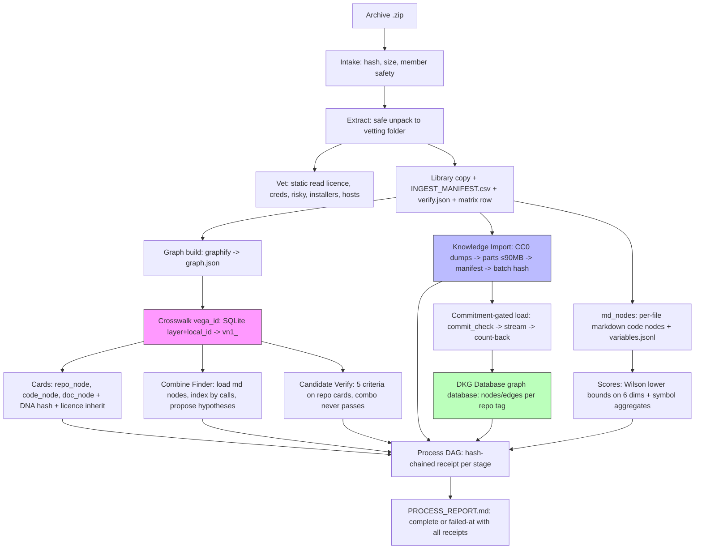

# vega-dkg-lattice-sdk — Architecture

## 1. The organism (family picture)

```
                 ┌──────────────────────────┐
                 │   THE HUMAN (the owner)  │  holds the only signing key;
                 │  authority starts here   │  spends it one action at a time
                 └────────────┬─────────────┘
                              v single-use signed commitments
 15 assemble   vega-umbrella-sdk        the family as one organism: one keyed
                                        ledger, one approval check, one anchor,
                                        registry + pre-deploy audit
 14 deliberate vega-council-sdk         multi-brain deliberation, design-first builder
               vega-galaxy-sdk          the galaxy view of the knowledge lattice:
                                        levels, convergence, futures above the present
 13 watch      vega-governance-feed-sdk  live view of every chain + tamper alarms
 12 verify     vega-metacog-sdk          evidence rungs and the completion gate
 11 reason     vega-reasoning-sdk        fidelity, forecasting, routing: the lattice
                                        that predicts steps ahead
 10 observe    vega-trace-sdk            telemetry of reasoning: layer traces, entropy,
                                        harmonic echo, reference signature
  9 interface  vega-terminal-sdk         gated command execution for people and agents
  8 learn      vega-train-sdk            governed training + freeze cards: records
                                        exactly what a model learned from
  7 knowledge >>> vega-dkg-lattice-sdk <<<   the knowledge graph: every fact with origin
                                        and licence; repo-library processing
  6 conduct    vega-harness-sdk          deterministic workflow conduct, pre-registered
                                        predicted paths, library use gate
  5 memory     vega-librarian-sdk        lessons and memory of past incidents
  4 contain    vega-two-gate-sdk         containment between two gates + the hard stop
  3 adapt      vega-pareah-sdk            adapters, cards, quarantine of inbound code:
                                        the dead-end room for the unannounced
  2 seal       vega-superproof-sdk       layered sealing and proof tiers
  1 authority  vega-governance-jacket-sdk human-only actions, single-use signed
                                        commitments, entry and exit gates
  0 record     vega-custody-sdk          capsules, DAG, hash-chained ledger, safe paths,
                                        bounded processes — the foundation everything
                                        writes to
```

**What layers below provide (layers 0–6):**
- Layer 0 (custody): capsules, DAG, hash-chained ledger, safe paths, bounded processes — the write foundation.
- Layer 1 (jacket): human-only commitments, entry/exit gates — authority source.
- Layer 2 (superproof): layered sealing and proof tiers — evidence integrity.
- Layer 3 (pareah): adapters, cards, quarantine — the dead-end room for inbound code.
- Layer 4 (two-gate): containment between two gates + hard stop — execution sandbox.
- Layer 5 (librarian): lessons and memory of past incidents — distilled from records.
- Layer 6 (harness): deterministic workflow conduct, pre-registered predicted paths, library use gate — consumes this repo's graph.

**Who above consumes this (layers 8–15):**
- Layer 8 (train): governed training + freeze cards — records what a model learned from the graph.
- Layer 11 (reasoning): fidelity, forecasting, routing — the predictive lattice (predict.py, galaxy) consumes the graph built here.
- Layer 14 (galaxy): galaxy view of the knowledge lattice — levels, convergence, futures.
- Layer 15 (umbrella): registry + pre-deploy audit — checks the family fits together.

## 2. Internal drawing: modules and flows

```
                          ┌─────────────────────┐
                          │   ARCHIVE (.zip)    │
                          └──────────┬──────────┘
                                     │ intake
                                     ▼
                          ┌─────────────────────┐
                          │  VETTING FOLDER     │
                          │  (safe extract)     │
                          └──────────┬──────────┘
                                     │ extract
                                     ▼
                    ┌────────────────┼────────────────┐
                    ▼                ▼                ▼
           ┌───────────────┐ ┌───────────────┐ ┌───────────────┐
           │  VET STAGE    │ │  LIBRARY COPY │ │  INGEST       │
           │  (static read)│ │  + MANIFEST   │ │  MANIFEST     │
           │  - licence    │ │  - verify.json│ │  - KEPT/SKIP  │
           │  - creds      │ │  - matrix row │ │  - sha256     │
           │  - risky      │ └───────┬───────┘ └───────┬───────┘
           │  - installers │         │                 │
           │  - hosts      │         ▼                 ▼
           └───────┬───────┘ ┌───────────────┐ ┌───────────────┐
                   │       │  MATRIX ROW   │ │  SOURCE FILES │
                   │       │  (license,    │ │  (KEPT only)  │
                   │       │   audit,      │ └───────┬───────┘
                   │       │   taint)      │         │
                   │       └───────┬───────┘         ▼
                   │               │        ┌─────────────────┐
                   │               ▼        │  MD_NODES       │
                   │        ┌──────────────┐ │  (per file)     │
                   │        │  GRAPH BUILD │ │  - symbols      │
                   │        │  (graphify)  │ │  - variables    │
                   │        │  graph.json  │ │  - scores       │
                   │        └──────┬───────┘ │  - no source    │
                   │               │         └────────┬────────┘
                   │               │                  │
                   ▼               ▼                  ▼
          ┌─────────────────────────────────────────────────────┐
          │              CROSSWALK (vega_id)                    │
          │  SQLite: layer + local_id → vega_id                 │
          │  - conflict reporting                               │
          │  - collision_group > 1 for duplicates               │
          └────────────────────────┬────────────────────────────┘
                                   │
              ┌────────────────────┼────────────────────┐
              ▼                    ▼                    ▼
    ┌─────────────────┐  ┌─────────────────┐  ┌─────────────────┐
    │    CARDS        │  │  COMBINE_FINDER │  │  CANDIDATE      │
    │  - repo_node    │  │  - load md nodes│  │  VERIFY         │
    │  - code_node    │  │  - index by     │  │  - 5 criteria   │
    │  - doc_node     │  │    shared calls │  │  - combo never  │
    │  - DNA hash     │  │  - propose hypo │  │    passes       │
    │  - licence      │  │    (strictest   │  │  - weaker       │
    │    inheritance  │  │     licence)    │  │    parent       │
    └────────┬────────┘  └────────┬────────┘  └────────┬────────┘
             │                    │                    │
             └────────────────────┼────────────────────┘
                                  ▼
                        ┌─────────────────┐
                        │  KNOWLEDGE      │
                        │  IMPORT         │
                        │  - Wikidata     │
                        │  - OpenAlex     │
                        │  - arXiv        │
                        │  - parts ≤90MB  │
                        │  - manifest     │
                        │  - batch hash   │
                        │  - commitment   │
                        │    gated load   │
                        │  - count-back   │
                        └────────┬────────┘
                                 │
                                 ▼
                        ┌─────────────────┐
                        │  DKG DATABASE   │
                        │  (graph database)        │
                        │  - nodes/edges  │
                        │  - tag per repo │
                        └─────────────────┘

AUTHORITY FLOW (down, human → world):
Human commitment → jacket gates → two-gate containment → world → record (custody)

DATA/KNOWLEDGE FLOW (up, record → human):
Custody records → librarian lessons → THIS REPO (graph with origin+licence)
  → reasoning/galaxy foresight → harness predicted paths → metacog evidence gate
  → governance feed/galaxy view → human decides again
```

**Module boxes (matching src/vega_dkg/):**
- vega_id.py — vn1_ IDs + Crosswalk (SQLite)
- cards.py — repo/code/doc cards, DNA hashes, licence inheritance
- md_nodes.py — markdown code nodes, symbols, variables, scores
- combine_finder.py — hypothesis cards from weak/strong pairs
- candidate_verify.py — 5 graph-fact criteria, combo never passes
- safe_paths.py — re-exports vega_custody.safepaths
- knowledge_import.py — CC0 dump → parts → manifest → commitment-gated load
- process.py — end-to-end pipeline (11 stages, receipt per stage)
- catalog.py — library improvement catalog per capability

## 3. Mermaid version



## 4. Sequence: main scenario end to end

```
Human provides .zip
      │
      ▼
Process Archive intake
      │
      ▼
Extract safe unpack to vetting folder
      │
      ▼
Vet (static read) ◀───▶ Library copy + manifest
      │                        │
      ▼                        ▼
md_nodes: symbols + scores    Graph build: graphify -> graph.json
      │                        │
      └───────────┬────────────┘
                  ▼
         Crosswalk assigns vega_id
         (conflict if same local_id different content)
                  │
      ┌──────────┼──────────┐
      ▼          ▼          ▼
   CARDS     COMBINE_FINDER  KNOWLEDGE IMPORT
   - repo_node - weak/strong - Wikidata/OpenAlex/arXiv
   - code_node   pairs by    - parts ≤90MB + manifest
   - doc_node    shared calls - batch hash
   - DNA hash    - hypo cards  - commitment gate
   - licence     - strictest   - count-back load
     inherit       licence
      │              │              │
      └──────────────┼──────────────┘
                     ▼
            CANDIDATE VERIFY
            - 5 criteria
            - combo never passes
                     │
                     ▼
            PROCESS DAG + REPORT
            COMPLETE or INCOMPLETE
            failed-at: stage
```

## 5. Trust boundaries

| Boundary | What crosses | What enforces it |
|---|---|---|
| Human → Commitment | Single-use signed commitment (action, params, expiry) | Human holds signing key; jacket gates verify signature, nonce, expiry |
| Commitment → Gate | Commitment presented to entry/exit gate | Gate checks signature, matches exact action+params, marks used (fail-closed) |
| Gate → Contained execution | Approved action runs in bounded process | vega_custody.proc.run_bounded (timeout, output cap, no network unless allowed) |
| Contained execution → Record | Result written to hash-chained ledger | vega_custody.dag.Dag.record — each entry fingerprints previous |
| Record → Librarian lesson | Record read, lesson distilled | Librarian SDK reads custody DAG, writes lesson cards with provenance |
| Librarian lesson → DKG graph | Lesson cards ingested as nodes/edges | This SDK: cards.build + knowledge_import — origin+licence per fact, DNA hash |
| DKG graph → Reasoning/Galaxy | Graph queried for foresight | Reasoning SDK predict.py, Galaxy SDK — consume graph, forecast |
| Reasoning → Harness predicted path | Forecast becomes pre-registered path | Harness SDK predicted_path — registered before execution |
| Harness → Metacog gate | Execution attempts, evidence required | Metacog SDK evidence rungs + completion gate |
| Metacog → Governance feed | Result shown to human | Feed SDK live view of chains + tamper alarms |
| Governance feed → Human | Human sees full picture, decides next | Human reads, signs next commitment — loop closes |

**Key trust shifts:**
- Human/model: Model never holds signing key; cannot mint/widen authority.
- Model/record: Model reasons freely inside the loop; every step lands in append-only chain verifiable without trusting the model.
- This kit/dependency (custody): This repo uses custody's safe paths, DAG, bounded runner — it does not reimplement them.
- This kit/dependency (harness use_gate): combine_finder calls use_gate.klass_of for strictest licence; it does not decide licence policy.
- Import/load: Human commitment gates the bulk load; count-back verifies nothing lost/duplicated; tampering caught before any store.
