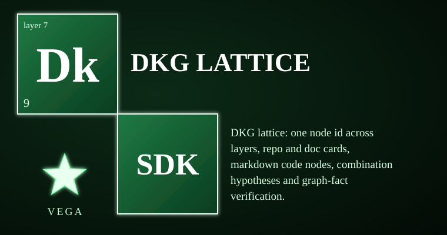

# vega-dkg-lattice-sdk


<!-- vega-install-order -->
> **Build order: 5/5. This kit needs 4 other Vega kits installed first.** Install them in this order, then this one:
> 1/5 `vega-custody-sdk`  
> 2/5 `vega-governance-jacket-sdk`  
> 3/5 `vega-librarian-sdk`  
> 4/5 `vega-harness-sdk`  
> 5/5 `vega-dkg-lattice-sdk` (this kit)
> Install each with `pip install --no-deps git+https://github.com/jasonblasiak868-code/<name>` in the order shown, plus `pip install cryptography`. Full steps: [INTEGRATION_GUIDE](https://github.com/jasonblasiak868-code/vega-umbrella-sdk/blob/main/INTEGRATION_GUIDE.md).

The knowledge graph layer: every fact carries its origin and licence. This SDK builds the graph from a repo library (code nodes, repo/doc cards, crosswalk IDs) and from offline CC0 sources (Wikidata, OpenAlex, arXiv metadata). It owns layer 7 — the licence-aware knowledge graph and repository-library processing. The predictive lattice side (forecasting, routing, fidelity) lives in vega-reasoning-sdk predict.py and the galaxy repo.

> **Licensing.** Source-available, not open source. Free for personal use; free for registered small businesses (under US$1M revenue and valuation); everyone else needs a commercial license (see LICENSE; for a commercial license write to jasonblasiak.ai.mail@gmail.com). Patent pending. Draft licence text, not yet reviewed by an attorney.

## Why this exists

A knowledge graph is only as trustworthy as its provenance. Most graphs mix facts with guesses, strip licences, and let any model write to them. This kit prevents three concrete failures:

- **Provenance loss**: every node and edge records the source (library repo or public dump), the licence class, and a content hash. Nothing is inferred or hallucinated into the graph.
- **Licence blindness**: the strictest licence of any upstream fact flows forward. A combination hypothesis inherits the stricter parent; the use gate (vega-harness-sdk) enforces what a build may do with it.
- **Unbounded growth**: imports read line by line from downloaded dumps, write size-capped parts with a manifest and batch hash, and load only under one human commitment for the exact batch. Count-back verifies nothing was lost or duplicated.

The graph side is built. The predictive lattice (routing, forecasting) is in vega-reasoning-sdk.

## Capabilities

| Capability | How you can check it |
|---|---|
| One cross-layer node ID (vn1_) with a conflict-reporting crosswalk | `vega_id.Crosswalk.add_many` — tests: `test_dkg.py::Ids` |
| Repo, code, and doc cards with vega IDs, licence inheritance, and DNA hashes | `cards.build` — tests: `test_dkg.py::Builders::test_cards_build_for_a_repo_with_a_graph` |
| Markdown code nodes per source file: symbols, variables, scores, no source text | `md_nodes.build_repo` — tests: `test_dkg.py::Builders::test_md_nodes_round_trip_into_the_combine_finder`, `test_md_nodes_hold_no_source_text` |
| Combination hypotheses: weak symbol paired with strong complement, indexed by shared calls, ranked, license-strict, tainted | `combine_finder.propose` — tests: `test_dkg.py::Finder`, `test_dkg.py::Builders::test_md_nodes_round_trip_into_the_combine_finder` |
| Graph-fact candidate verification (5 criteria, combination never passes on its own) | `candidate_verify.verify_node`, `verify_candidate` — tests: `test_dkg.py::Verify` |
| Safe path rules for untrusted repos (containment, size caps, atomic writes) | `safe_paths` (re-exports `vega_custody.safepaths`) — used by every module above |
| Offline CC0 knowledge import: Wikidata, OpenAlex, arXiv metadata; parts, manifest, batch hash, commitment-gated load, count-back | `knowledge_import.import_dump`, `load` — tests: `test_knowledge_import.py::Reading`, `Records`, `Parts`, `Loading` |
| End-to-end repo processing: intake → extract → vet → library → md_nodes → graph → cards → scores → DAG → DKG load → report | `process.process` — tests: `test_process.py::Workflow`, `NeverHalfDone` |
| Library improvement catalog: capability tagging by keyword evidence, symbol scoring, license route, target repo mapping | `catalog.build` — integration covered by `test_dkg.py::Builders` flow |

## Where it sits in the family

```
                 ┌──────────────────────────┐
                 │   THE HUMAN (the owner)  │
                 └────────────┬─────────────┘
                              v single-use signed commitments
 15 assemble   vega-umbrella-sdk
 14 deliberate vega-council-sdk / vega-galaxy-sdk
 13 watch      vega-governance-feed-sdk
 12 verify     vega-metacog-sdk
 11 reason     vega-reasoning-sdk     (predictive lattice: predict.py, galaxy)
 10 observe    vega-trace-sdk
  9 interface  vega-terminal-sdk
  8 learn      vega-train-sdk
  7 knowledge >>> vega-dkg-lattice-sdk <<<   the knowledge graph: origin + licence per fact; repo-library processing
  6 conduct    vega-harness-sdk
  5 memory     vega-librarian-sdk
  4 contain    vega-two-gate-sdk
  3 adapt      vega-pareah-sdk
  2 seal       vega-superproof-sdk
  1 authority  vega-governance-jacket-sdk
  0 record     vega-custody-sdk         capsules, DAG, safe paths, bounded processes
```

**Dependencies (registry requires=vega-custody-sdk; code also uses vega-harness-sdk `use_gate`):**
- vega-custody-sdk — capsules, DAG, safe paths, bounded processes (foundation)
- vega-harness-sdk — `use_gate` licence classification for combination hypotheses

**Consumers:** vega-harness-sdk (harness uses the graph for predicted paths), vega-librarian-sdk (lessons from the graph), vega-reasoning-sdk (predictive lattice forecasts from the lattice), vega-galaxy-sdk (galaxy view).

One family, one organism: every SDK owns exactly one concern and uses the owner of every other concern instead of growing its own copy.

## Quick start

```bash
# Put src/ of this repo and its dependencies on PYTHONPATH
export PYTHONPATH="$PWD/src:/path/to/vega-custody-sdk/src:/path/to/vega-harness-sdk/src"

# One pure-function quick check: generate a cross-layer ID
python3 -c "
from vega_dkg import vega_id as vid
print(vid.vega_id('myrepo', 'src/main.py', 'function', 'fetch', 'L10', 0))
# vn1_<26 hex chars> — deterministic, collision-flagged, never merged
"
```

## What it does NOT do

- **Not a security review.** The vet stage is a static read; it finds credential-shaped values and risky calls but proves nothing about runtime behaviour.
- **Containment is process-level, not an OS sandbox.** `safe_paths` and the bounded runner keep files inside a folder; they do not isolate memory, network, or syscalls.
- **Licence matrix is policy, not legal advice.** The strictest detected class flows forward; counsel decides what that means for your build.
- **Scores measure structure, not whether code works.** Wilson lower bounds on documentation, tests, graph connectedness, extracted edges — a high score does not mean the code is correct.
- **Hypothesis cards are ranked ideas, not tried merges.** A combination becomes a candidate only after a contained run passes tests and a replay reproduces the result hash.
- **Wikipedia text and WikiLeaks are not imported.** Share-alike and provenance/legal problems make them unsuitable for this graph; they would need separate adapters.
- **Multi-language symbol extraction needs `tree-sitter-language-pack` (optional extra).** Without it, non-Python files get file-level nodes only.
- **The predictive lattice (routing, forecasting, fidelity) lives in vega-reasoning-sdk `predict.py` and the galaxy repo.** This SDK builds the graph; it does not forecast.

## Tests

96 tests in 6 files, all passing (STATUS.md). Run with the dependency `src/` folders on PYTHONPATH:

```bash
python -m pytest tests/ -v
# or run each file directly:
python tests/test_dkg.py
python tests/test_knowledge_import.py
python tests/test_process.py
```

## Status & honesty

Reference implementation, work in progress, not independently security-reviewed, crypto not expert-reviewed. PARTIAL status: the graph side is built; the predictive lattice side lives in vega-reasoning-sdk `predict.py` and the galaxy repo. This kit details one branch of a broader filed architecture. The remaining branches are the subject of filed disclosures and are outside the scope of this repository.
